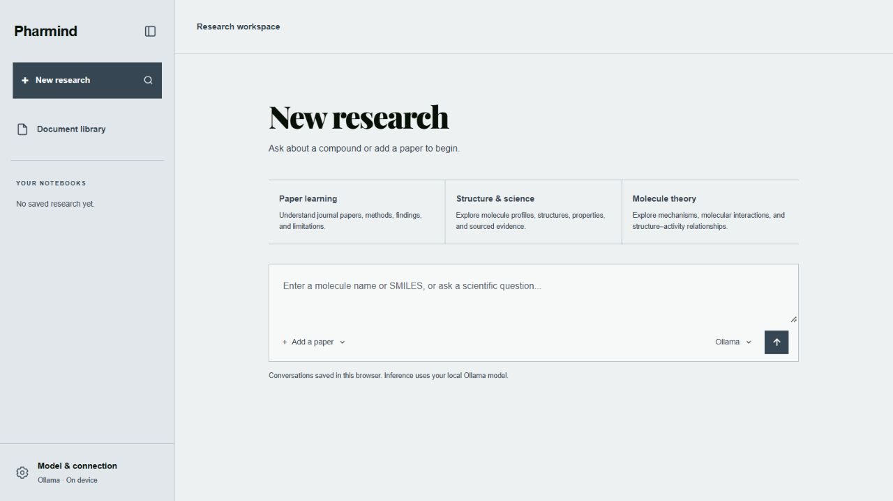
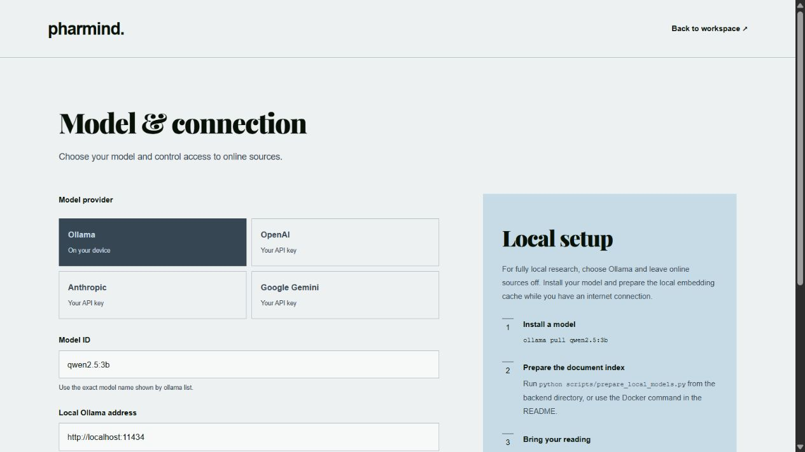
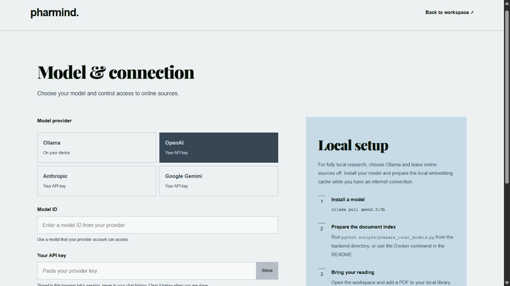

# Pharmind Local

A local pharmacology research workspace. Read papers, explore compounds, and keep a browser-based research notebook with an AI model you choose.

The interface uses Playfair Display Black, Helvetica Neue / Arial, and a restrained slate, ink, mauve, steel, and pale-blue palette. Fonts are served locally.

## Screenshots

### Research workspace

Start directly in the workspace, choose a research mode, and keep your notebooks in the sidebar.



<details>
<summary>Local model setup</summary>

Configure an installed Ollama model and its local endpoint.



</details>

<details>
<summary>Bring your own key</summary>

Choose your provider and enter your own model ID and API key. No credentials are shown in this screenshot.



</details>

## Choose how your AI runs

- **Local:** Ollama runs a downloaded model on your computer. Online literature sources are off by default. Research requests use cached embedding and reranking models and your local document index.
- **Bring your own key:** OpenAI, Anthropic, and Google Gemini are optional. Your questions, conversation context, and selected evidence are sent through your local backend to the provider you select. The provider's terms and charges apply. This mode is not offline inference.
- **Online sources:** A separate, explicit setting enables literature searches and compound lookups through public databases. Choosing a cloud AI provider does not automatically enable these searches.

Pharmind has no account, trial, subscription, or shared service key. It is intended for a trusted, single-user local installation; keep its ports bound to loopback rather than exposing them publicly.

For research and education only. Generated answers need source verification and are not medical advice.

## Start with Docker

Docker builds the Pharmind frontend and backend. It does **not** install Ollama on your computer or download an answer-generating model. Ollama runs separately on the host. The embedding/reranking models prepared below support document retrieval and do not write answers.

1. Install and start Docker Desktop.
2. Copy `backend/.env.example` to `backend/.env` if it does not exist. The example defaults to Ollama and disables online sources.
3. Run `docker compose up -d --build`.
4. Prepare the document models once while connected to the internet:

   ```sh
   docker compose exec -T backend python scripts/prepare_local_models.py
   ```

5. For local inference, install Ollama on your host, start it, and download a model:

   ```sh
   ollama pull qwen2.5:3b
   ```

6. Open [connection settings](http://localhost:3001/settings). For Ollama, the app detects installed models and flags a missing selection or unavailable service. Choose an installed answer model from the list, test the connection, and save it for this browser session. Refresh the list after downloading another model. Embedding-only models cannot be selected for answers. For BYOK, enter your provider's model ID and key.
7. Open the workspace and add a PDF through **Document library** or **Add a paper**.

On Windows, `start-pharmind-local.bat` builds the containers, prepares the document model cache, and opens the workspace. It does not ask for a cloud key or automatically ingest online literature. Use `stop-pharmind-local.bat` to stop the app.

Initial dependency and model downloads require internet access. After preparation, local mode can operate offline. If a model is missing, the app reports the setup step instead of downloading it during your research request.

The Docker backend reaches host Ollama through `host.docker.internal`. The default localhost address in the UI maps to the configured `OLLAMA_BASE_URL`. Both versions can use the same host Ollama installation and downloaded inference models.

### Separate from the original Pharmind

| Resource | Pharmind Local |
| --- | --- |
| Compose project | `pharmind-local` |
| Workspace | `http://localhost:3001` |
| Backend | `http://localhost:8001` |
| Containers | `pharmind-local-frontend-1`, `pharmind-local-backend-1` |
| Research data volume | `pharmind-local_research-data` |
| Document model cache volume | `pharmind-local_model-cache` |

Docker still uses ports `3000` and `8000` inside its private network. Only host ports `3001` and `8001` are published, bound to `127.0.0.1`. The UI's internal backend address remains `http://backend:8000`.

The Compose file declares its project name explicitly. The Windows launchers also pin the project name and Compose file, so starting or stopping this version targets Pharmind Local even if another project name is set in your shell. When using Compose manually, do not override the name with the original application's `-p` or `COMPOSE_PROJECT_NAME` value.

Research data and document-model caches start in new volumes. Existing containers, volumes, and `./data` folders are not migrated or deleted. Re-upload papers into this version when needed. Browser notebooks and session keys from port `3000` are separate from port `3001`; re-enter your model connection in the new workspace.

Stop only this installation with:

```sh
docker compose --project-name pharmind-local down
```

The stop launcher uses the same command and keeps both volumes. Avoid `down --volumes` unless you intend to delete this installation's stored data and model cache. Changing the project name does not rename or stop containers from an earlier installation.

The optional root single-container Dockerfile also retains its internal ports. If using it instead of Compose, build it as `pharmind-local` and map `127.0.0.1:3001:3000` and `127.0.0.1:8001:8000`.

## Start without Docker

Use Python 3.13 and Node.js 22, matching the Docker and CI environments. Install the pinned dependencies:

```sh
cd backend
python -m venv .venv
# Activate .venv for your shell, then:
pip install -r requirements.txt
python scripts/prepare_local_models.py
uvicorn main:app --host 127.0.0.1 --port 8001
```

In another terminal:

```sh
cd frontend
npm ci
npm run dev
```

Open [Pharmind Local](http://localhost:3001) to start in the workspace. Configure your model through **Model & connection** in the sidebar.

## Where your information lives

| Information | Location |
| --- | --- |
| Conversations and notebooks | Browser local storage |
| Connection and entered API key | This tab's session storage; clear with **Forget saved connection** |
| Uploaded PDFs and extracted passages | Docker: `pharmind-local_research-data`; without Docker: local backend data directory |
| Embedding and reranking models | Docker: `pharmind-local_model-cache`; without Docker: `PHARMER_MODEL_CACHE`, default `backend/.cache` |
| BYOK requests | Selected provider, via the local backend |

Entered keys are not written to backend files, included in chat history, or returned by the connection test. Session storage is accessible to scripts on the app's origin; it is not an encrypted credential vault. Environment variables remain available for command-line workflows. Browser requests carry their own selected settings, independently of those variables.

Connection testing checks Ollama's installed model list and reported generation capabilities, or the selected provider's model endpoint. It does not send a research prompt, verify answer quality, or measure whether a model fits your available memory. Older Ollama versions may not report capabilities; these models are marked as unverified. The workspace shows a setup notice when its saved Ollama model is missing or the service cannot be reached. Models are never switched or downloaded automatically.

The structure editor is bundled and served locally, including its templates. It works with online sources off. External structure images and database lookups require online sources to be enabled. Clicking an external citation is a deliberate visit to that source.

## Research workflow

- **Paper learning:** Upload a text-based PDF (up to 20 MB and 500 pages), or choose **Use paper** from the document library. Answers search only the selected document. Its selection is saved with the notebook. Unlink it to return to broader research.
- **Document library:** Originals are saved locally and can be viewed from the library or a citation. Identical uploads with the same compound tag are deduplicated. Different files with the same filename stay separate. Choose **Replace** before uploading an updated PDF to remove the old passages and original file. Deleting a paper clears its notebook selections; existing answers remain in your notebooks.
- **Structure & science:** Enter a compound name or SMILES to explore structures and grounded profiles. Offline name resolution depends on locally available records; import literature or use SMILES when a compound is unavailable.
- **Molecule theory:** Ask about mechanisms, interactions, and structure–activity relationships.
- **Notebooks:** Conversations are saved in the browser and can be reopened or deleted from the sidebar. **Export** downloads a JSON backup; **Import** merges a backup, keeping the newer version of notebooks with matching IDs. Backups contain conversations and document references, not PDF files, model caches, or connection credentials. Back up the research-data volume separately for PDFs and their index.
- **References:** Inline references open retrieved passages and PDF pages. Passages consulted by a model that supplied no valid citation markers are labelled separately from claim citations.
- **Comparisons:** Choose any two profiles from the current notebook. Missing regulatory or safety evidence is shown as unavailable.
- **Long requests:** Use **Stop request** to cancel a model request. Chat requests time out after five minutes; structured profiles after fifteen. PDF indexing runs in a worker thread and finishes independently if the library is closed.

In **Model & connection**, use **Check local readiness** to check the embedding cache and document count. **Test connection** checks your chosen inference model separately. A cached reranker is optional; without it, results use vector ranking.

## Current limits

- Scanned and image-only PDFs require OCR before upload. Equations, complex tables, and multi-column layouts can lose structure during text extraction.
- Ordinary chat returns a completed answer. Structured profiles stream progress and local Ollama tokens; cloud structured responses currently arrive as one completed result.
- Older indexed PDFs may lack original files. Re-upload them to enable PDF viewing. Notebook backups do not reconstruct the document library.
- Small-model scientific accuracy and citation support still require broader evaluation. Passing software tests does not establish clinical reliability.
- Chroma is used as an embedded local database, with no Chroma HTTP server. The latest available package still has upstream server authorization/code-injection advisories with no published fixed version at this check. Those server endpoints are not exposed by this application; keep this a loopback-only, single-user installation and monitor upstream fixes.

## Checks

```sh
cd frontend
npm run lint
npm run typecheck
npm test
npm run build
```

```sh
cd backend
python -m unittest scripts.test_connection scripts.test_documents scripts.test_requests -v
python -m compileall -q rag ingest main.py
```

Tests cover provider isolation and credential redaction, document isolation, real PDF extraction into a temporary Chroma collection, replacement/deletion, original PDF serving, citation preservation, disconnect cancellation, readiness, notebook backup validation, and stream parsing. Providers and embeddings are mocked; these checks need no real keys, downloaded models, or running Ollama. GitHub Actions runs lint, types, frontend tests/build, and offline backend tests on pushes and pull requests.

## License

MIT. Playfair Display is bundled under the SIL Open Font License in `frontend/public/fonts/OFL.txt`.

The bundled [JSME molecule editor](https://github.com/jsme-editor/jsme-editor.github.io) is distributed under BSD-3-Clause. Its pinned npm assets and upstream license notices from `frontend/vendor/jsme` are copied into `public/jsme` by the development/build scripts.
